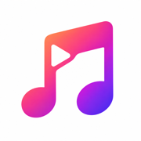
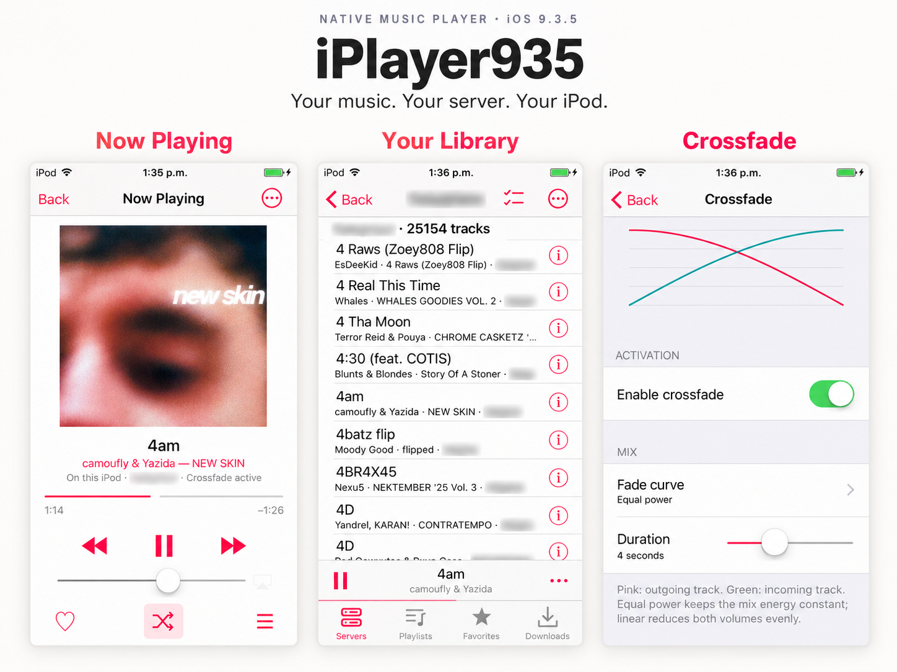
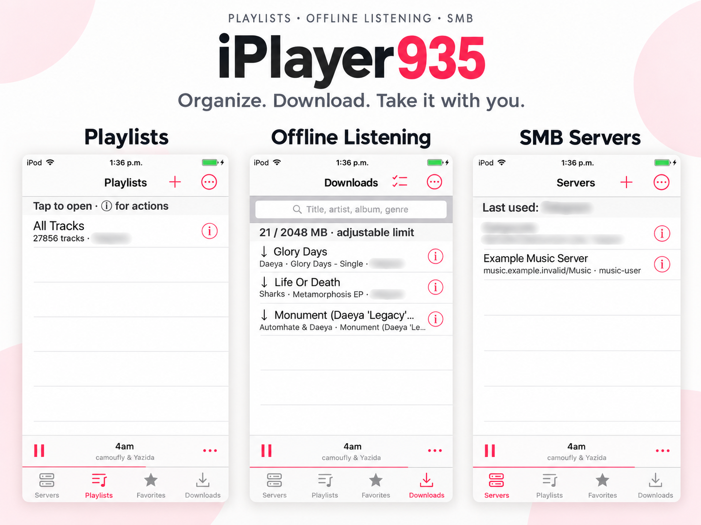

<p align="center">
  
</p>
<h1 align="center">iPlayer935</h1>

[English](README.md) · [Español](README.es.md) · [简体中文](README.zh-CN.md)

A native music player for **iPod touch 5 running iOS 9.3.5**. Stream your own music from an SMB server, keep songs available offline, and enjoy an interface inspired by the iPod's classic Music app.





*Promotional compositions based on real iPod screenshots. Private server details are blurred.*

## Features

- SMB2/SMB3 access to your own music server, with multiple profiles and passwords stored in Keychain.
- MP3, AAC/M4A, ALAC, WAV/AIFF/CAF playback through iOS; FLAC, Ogg Vorbis and Opus decoding through FFmpeg.
- Persistent metadata and artwork caching, with progress, pause and resume controls.
- Search and sorting by title, artist, album, genre, track number or file modification date.
- A persistent mini player, full Now Playing view, favorites and multi-song actions.
- Playlists and M3U/M3U8 import, shuffle, and restoration of the last song, position and queue.
- Adjustable crossfade with equal-power or linear curves, independent manual/automatic transitions, and a session toggle.
- Manual downloads and a bounded automatic cache that preloads upcoming songs in the queue.
- English, Spanish and Simplified Chinese, with an in-app language selector and a system-language option.

## Download and install

Download **iPlayer935.ipa** from the [latest release](https://github.com/neura-neura/iplayer935/releases/latest). Release notes and matching source/relinking packages are provided there in English.

The supported target is a **jailbroken iPod touch 5 (iPod5,1), iOS 9.3.5, ARMv7**, with **AppSync Unified** already installed. Other devices and iOS versions have not been validated.

To install from a Mac over USB, clone this repository, put the downloaded IPA at `deliverables/iPlayer935.ipa`, connect and unlock the iPod, and trust the computer if prompted:

```sh
brew install libimobiledevice ideviceinstaller
./scripts/install.sh
```

Installing an update with the same app identifier preserves the app's data. Do not uninstall first if you want to keep your library, settings and downloads.

## Connect your music

1. Open **Servers**. New installations include **Local** and **Example Music Server**, a fictional profile that does not connect automatically. Tap it to enter your own server details, or use **+** to add a profile. Each field includes help.
2. Enter the server IP/hostname without `smb://`, the SMB share name, an optional folder relative to that share, and your SMB credentials. Example: host `music-server.local`, share `Music`, folder `Albums/Rock`. Use an account authorized for SMB; an SSH account may have different permissions.
3. Save, then use **ⓘ → Test connection**. Open the server to browse its library. The app reads the music share without modifying server files.
4. Use **⋯ → Refresh library and M3U** to force a scan. Automatic checks run when entering a server and while its library is visible, with a 15-minute interval between checks. They are background scans, not instant server notifications.
5. Metadata and artwork are cached locally. Check or pause progress in **⋯ → Tag cache status**. Already checked, unchanged files are not reprocessed every time the app opens.

**Local** is a fixed, read-only source for iTunes music, completed downloads/cache and readable audio files in the app’s Documents folder or `/var/mobile/Media`. Use file sharing or a file manager to copy music there. It refreshes in the background on entry and while visible (at most once per minute); **⋯ → Refresh local library** forces a scan. Unchanged tags and artwork remain cached. Protected or cloud-only iTunes items cannot be played.

## Playback and offline listening

Tap a song to play without leaving the list. Tap the mini player to open Now Playing; return with **Back** or a swipe from the left edge. Shuffle and crossfade controls are available in the player; crossfade settings are under **⋯**. Long-press shuffle to suspend or resume crossfade when that session control is enabled.

Use the selection icon in a song list, select tracks, then open **⋯** for batch actions. Create playlists from **Playlists → +**. Song information menus provide favorite, playlist and download actions.

Manage manual downloads in **Downloads**. Open **Downloads → ⋯ → Automatic cache** to adjust the upcoming-song cache and inspect available songs. Only fully downloaded files are available offline; automatic cache entries can be evicted to respect its size limit. To access an uncached remote song, the iPod must have a route to the SMB server, such as the same network or an existing VPN.

## Performance and compatibility

The library uses SQLite indexes, paginated lists and background work to handle large collections. Initial scanning and metadata caching still take time, especially over a slow server connection; browsing and playback remain available during preparation.

A file extension does not guarantee codec compatibility. WMA is not supported. FLAC playback, seeking and offline playback have been checked on the physical iPod; real-world Ogg/Opus playback still needs broader device testing. See [validation notes](docs/VALIDATION.md) for tested behavior and limitations.

## Build and development

The app is written in Objective-C/UIKit and targets ARMv7. Build scripts use LLVM, ldid and a pinned legacy iOS SDK; this is not a modern Xcode project.

```sh
brew install llvm ldid libimobiledevice ideviceinstaller
./scripts/build.sh
```

The output is `deliverables/iPlayer935.ipa`. See [build instructions](docs/BUILD.md), [architecture](docs/ARCHITECTURE.md), [SMB integration](docs/SMB.md) and [localization](docs/LOCALIZATION.md). Test runners are in `Tests/`; some require codec libraries built by `scripts/codec-build.sh`.

## Credits and dependencies

Made by [neura-neura](https://github.com/neura-neura).

The app includes [libsmb2](https://github.com/sahlberg/libsmb2) and [FFmpeg](https://ffmpeg.org/), with their LGPL notices in `Vendor/libsmb2` and `deliverables/licences`. Releases include matching source and relinkable objects; see [build instructions](docs/BUILD.md) for rebuilding dependencies. Album artwork and song names in screenshots belong to their respective owners. This is an independent project and is not affiliated with Apple or Spotify.
